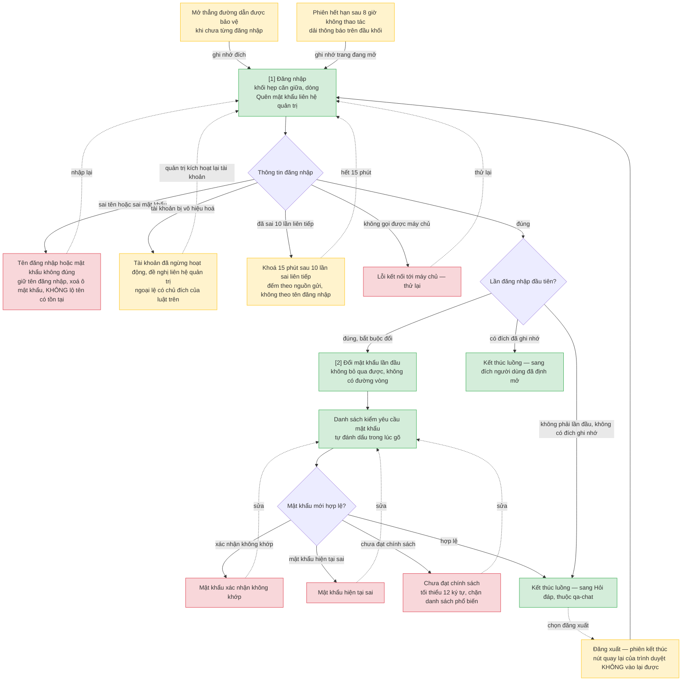
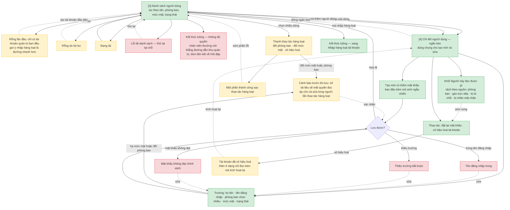
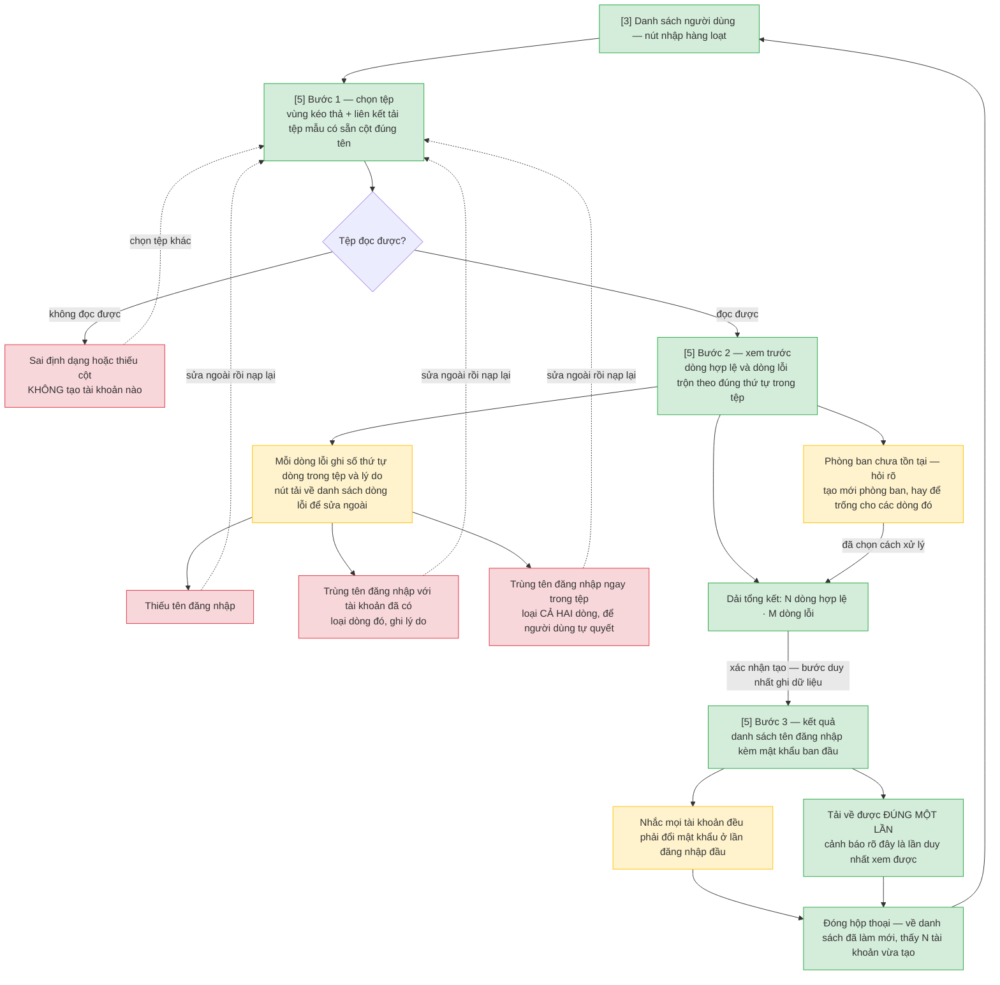
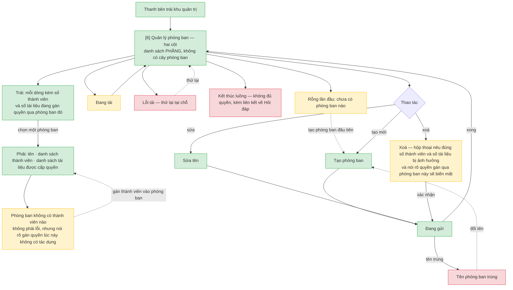

# Tài khoản và phân quyền — User Flow

> Nguồn chia luồng duy nhất của tính năng này. Khung vẽ **1024 điểm ảnh** cho cả bốn luồng, theo
> `NFR-system-042` và mục 8 của hệ thống thị giác.

Khối gán quyền đọc tài liệu **cố ý không nằm trong bốn luồng này** — quyền gắn với tài liệu nên nó
sống ở màn Chi tiết tài liệu của `doc-ingestion`. Đây là quyết định có chủ đích, không phải bỏ sót.

## 1. User Flow (tổng)

### Flow: vao-he-thong

### Flow: quan-ly-nguoi-dung

### Flow: nhap-hang-loat

### Flow: quan-ly-phong-ban

## 2. Danh sách màn hình

| [#] | Slug | Mã màn | Màn hình | Mục đích | Luồng nhà | Dùng chung ở |
|-----|------|--------|----------|----------|-----------|--------------|
| 1 | `dang-nhap` | `SCR-access-control-01` | Đăng nhập | Màn duy nhất người chưa đăng nhập vào được | `vao-he-thong` | — |
| 2 | `doi-mat-khau-lan-dau` | `SCR-access-control-02` | Đổi mật khẩu lần đầu | Buộc đổi mật khẩu ban đầu trước khi dùng hệ thống | `vao-he-thong` | — |
| 3 | `danh-sach-nguoi-dung` | `SCR-access-control-03` | Danh sách người dùng | Tìm và thao tác trên tài khoản, đơn lẻ hoặc hàng loạt | `quan-ly-nguoi-dung` | `nhap-hang-loat` |
| 4 | `chi-tiet-nguoi-dung` | `SCR-access-control-04` | Chi tiết người dùng | Tạo mới hoặc sửa một tài khoản, và thấy người đó đọc được gì | `quan-ly-nguoi-dung` | — |
| 5 | `nhap-hang-loat` | `SCR-access-control-05` | Nhập hàng loạt tài khoản | Tạo nhiều tài khoản từ một tệp, có bước xem trước | `nhap-hang-loat` | — |
| 6 | `quan-ly-phong-ban` | `SCR-access-control-06` | Quản lý phòng ban | Trông coi danh sách phòng ban phẳng và quyền gán qua chúng | `quan-ly-phong-ban` | — |

## 3. Danh sách flow

| Flow-slug | Tên flow | Màn hình gồm | Cases phủ |
|-----------|----------|--------------|-----------|
| `vao-he-thong` | Vào hệ thống | `dang-nhap` → `doi-mat-khau-lan-dau` | happy · đăng xuất kèm chặn nút quay lại · sai thông tin · tài khoản vô hiệu hoá · khoá 15 phút · lỗi kết nối · phiên hết hạn · mở thẳng đường dẫn khi chưa đăng nhập · mật khẩu không khớp, sai, hoặc chưa đạt chính sách |
| `quan-ly-nguoi-dung` | Quản lý người dùng | `danh-sach-nguoi-dung` → `chi-tiet-nguoi-dung` | happy tạo và sửa · cảnh báo mất quyền đọc trước khi lưu, cả đơn lẻ lẫn hàng loạt · trùng tên đăng nhập · thiếu trường · mật khẩu không đạt · tài khoản đã vô hiệu hoá · rỗng lần đầu · rỗng do lọc · đang tải · lỗi · không đủ quyền · một phần thành công |
| `nhap-hang-loat` | Nhập hàng loạt tài khoản | `danh-sach-nguoi-dung` → `nhap-hang-loat` | happy ba bước · sai định dạng hoặc thiếu cột · thiếu tên đăng nhập · trùng với tài khoản đã có · trùng ngay trong tệp · phòng ban chưa tồn tại · mật khẩu ban đầu xem một lần |
| `quan-ly-phong-ban` | Quản lý phòng ban | `quan-ly-phong-ban` | happy tạo, sửa, xoá · xoá có nêu số liệu ảnh hưởng · tên trùng · phòng ban không có thành viên · rỗng lần đầu · đang tải · lỗi · đang gửi · không đủ quyền |

## 3.5. Chuyển màn

| Từ màn [#] | Đến màn [#] | Trigger | Điều kiện |
|-----------|------------|---------|-----------|
| Đăng nhập [1] | Đổi mật khẩu [2] | Đăng nhập thành công | Là lần đăng nhập đầu tiên |
| Danh sách người dùng [3] | Chi tiết [4] | Bấm một dòng, hoặc nút *thêm người dùng* | Cùng ngăn kéo cho cả tạo mới và sửa |
| Danh sách người dùng [3] | Nhập hàng loạt [5] | Nút *nhập hàng loạt* | — |
| Nhập hàng loạt [5] | Danh sách người dùng [3] | Đóng hộp thoại ở bước 3 | Danh sách làm mới, thấy các tài khoản vừa tạo |
| Chi tiết [4] | Danh sách người dùng [3] | Lưu thành công, hoặc đóng ngăn kéo | — |

**Lối vào và lối ra khỏi phạm vi tính năng:**

- Thanh bên khu quản trị → **Quản lý phòng ban [6]**, bấm mục *Phòng ban*. Ba màn quản trị còn lại
  cũng vào từ thanh bên này.
- Đăng nhập [1] → màn **Hỏi đáp** của `qa-chat`, khi đăng nhập thành công mà không phải lần đầu và
  không có đích đã ghi nhớ.
- Đăng nhập [1] → **đích người dùng đã định mở**, khi trước đó họ mở thẳng đường dẫn được bảo vệ
  hoặc phiên vừa hết hạn.
- Đổi mật khẩu [2] → màn **Hỏi đáp** của `qa-chat` ngay sau khi đổi thành công, không bắt đăng nhập
  lại.
- Bất kỳ màn nào → **Đăng nhập [1]**, khi chọn đăng xuất hoặc phiên hết hạn. Phiên kết thúc và nút
  quay lại của trình duyệt không đưa vào lại được.

## 4. Điều phải giữ khi vẽ wireframe và viết spec

- **Sai thông tin đăng nhập chỉ có một thông báo duy nhất.** Phân biệt được sai tên với sai mật
  khẩu là đủ để dò ra danh sách nhân sự của doanh nghiệp.
- **Bộ đếm 10 lần sai đếm theo nguồn gửi, không theo tên đăng nhập** (chốt 2026-09-09). Nếu đếm
  theo tên đăng nhập thì tên có thật sẽ bị khoá còn tên bịa thì không — chính khác biệt hành vi đó
  là kênh dò tài khoản, dù chữ nghĩa hai bên giống hệt nhau.
- **Đăng xuất phải làm phiên cũ không dùng lại được**, kể cả qua nút quay lại của trình duyệt.
- **Quên mật khẩu không tự phục vụ** — hệ thống chạy nội bộ, chưa có kênh gửi thư. Màn đăng nhập
  cần một dòng chữ tĩnh chỉ đường liên hệ quản trị, để người dùng không rơi vào ngõ cụt.
- **Danh sách phòng ban phẳng, không có cây.** Kế thừa quyền theo cây là nguồn lỗi phân quyền phổ
  biến nhất — lý do ghi ở US-004.

## 5. Việc phải đồng bộ ngược sang wireframe index

> Chủ ghi của `ascii-wireframe/access-control-wireframe-index.md` là `/wireframe-ascii`. Áp khi
> chạy skill đó, qua L2 diff.

1. **Cột *Thuộc luồng* hiện gộp bốn màn quản trị vào một luồng duy nhất.** Userflow này chia thành
   ba luồng (`quan-ly-nguoi-dung`, `nhap-hang-loat`, `quan-ly-phong-ban`) — cột đó phải cập nhật
   theo, nếu không hai nguồn lệch nhau ngay từ đầu chuỗi tài liệu.
2. **Thêm dòng chữ chỉ đường quên mật khẩu** vào mô tả màn Đăng nhập.
3. **Thêm cột `Slug` vào bảng Screens của wireframe index**, lấy đúng slug ở Mục 2 trên. Hiện index
   chỉ có mã màn và tên tiếng Việt, nên đồ thị tri thức tự suy slug từ tên và sinh ra node trùng
   (`nhap-hang-loat-tai-khoan` bên cạnh `nhap-hang-loat`). Slug ở userflow là bản chuẩn.

## 6. Open Questions

- [ ] OQ-1: Thao tác *đặt lại mật khẩu* cho một người ở màn Chi tiết người dùng hiển thị kết quả
      thế nào? Nhập hàng loạt đã chốt là xem được đúng một lần; thao tác đơn lẻ có cùng ràng buộc
      đó không thì chưa nguồn nào nói.
- [ ] OQ-2: Đóng ngăn kéo Chi tiết người dùng lúc đang có thay đổi chưa lưu thì cảnh báo hay bỏ?
