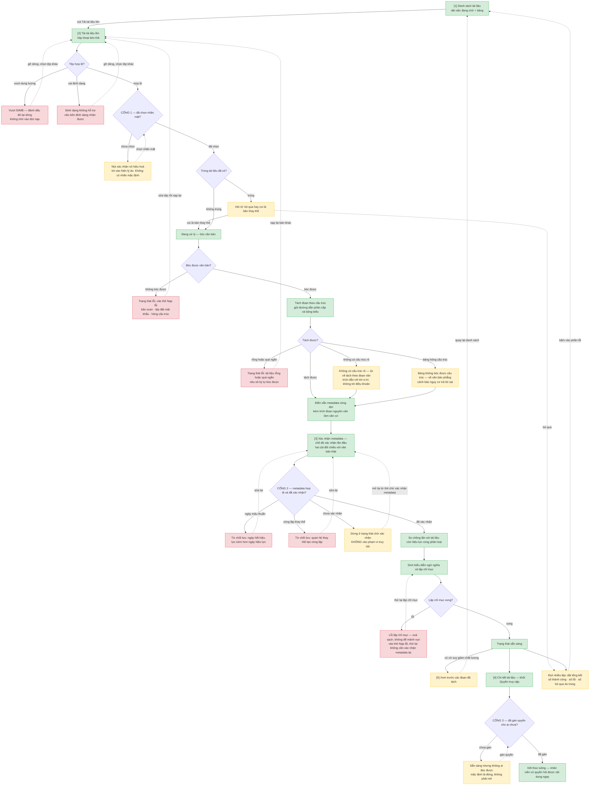
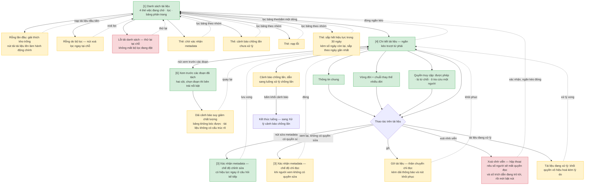
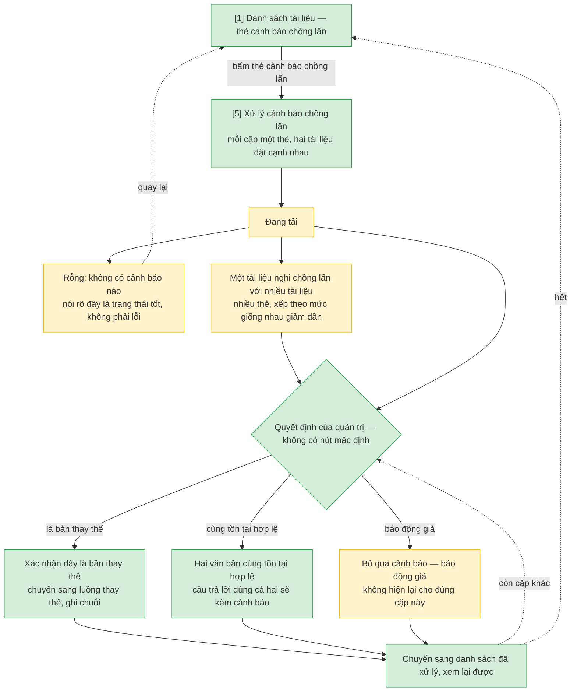

# Nạp và quản lý vòng đời tài liệu — User Flow

> Nguồn chia luồng duy nhất của tính năng này. Khung vẽ **1024 điểm ảnh**.

Ba luồng dùng chung hai màn: *Danh sách tài liệu* là điểm khởi phát của cả ba, *Chi tiết tài liệu*
vừa là nơi cổng thứ ba của luồng nạp diễn ra vừa là màn trung tâm của luồng quản lý kho. Mỗi màn
vẫn chỉ được vẽ một lần, ở luồng nhà của nó — xem Mục 2.

## 1. User Flow (tổng)

### Flow: nap-tai-lieu

> Ba cổng chặn nằm trên đúng luồng này. Không có đường nào vòng qua chúng.

### Flow: quan-ly-kho-tai-lieu

### Flow: xu-ly-chong-lap

## 2. Danh sách màn hình

| [#] | Slug | Mã màn | Màn hình | Mục đích | Luồng nhà | Dùng chung ở |
|-----|------|--------|----------|----------|-----------|--------------|
| 1 | `danh-sach-tai-lieu` | `SCR-doc-ingestion-01` | Danh sách tài liệu | Trông coi kho ở quy mô 1.000 tài liệu, và trả lời "hôm nay phải làm gì" | `quan-ly-kho-tai-lieu` | `nap-tai-lieu`, `xu-ly-chong-lap` |
| 2 | `tai-tai-lieu-len` | `SCR-doc-ingestion-02` | Tải tài liệu lên | Chọn tệp, đặt nhãn mật và phân loại cho cả đợt | `nap-tai-lieu` | — |
| 3 | `xac-nhan-metadata` | `SCR-doc-ingestion-03` | Xác nhận metadata vòng đời | Đối chiếu metadata máy điền với văn bản thật rồi xác nhận | `nap-tai-lieu` | `quan-ly-kho-tai-lieu` (chế độ chỉnh sửa và chỉ đọc) |
| 4 | `chi-tiet-tai-lieu` | `SCR-doc-ingestion-04` | Chi tiết tài liệu | Xem vòng đời, gán quyền, gỡ hoặc xoá | `quan-ly-kho-tai-lieu` | `nap-tai-lieu` (cổng 3 gán quyền) |
| 5 | `xu-ly-chong-lap` | `SCR-doc-ingestion-05` | Xử lý cảnh báo chồng lấn | Quyết từng cặp tài liệu nghi chồng lấn | `xu-ly-chong-lap` | — |
| 6 | `xem-truoc-doan` | `SCR-doc-ingestion-06` | Xem trước các đoạn đã tách | Kiểm chất lượng tách đoạn trước khi tin vào kho | `quan-ly-kho-tai-lieu` | `nap-tai-lieu` (khi có cờ suy giảm chất lượng) |

## 3. Danh sách flow

| Flow-slug | Tên flow | Màn hình gồm | Cases phủ |
|-----------|----------|--------------|-----------|
| `nap-tai-lieu` | Nạp tài liệu vào kho | `danh-sach-tai-lieu` → `tai-tai-lieu-len` → `xac-nhan-metadata` → `chi-tiet-tai-lieu` | happy 12 bước · ba cổng chặn · lỗi trước khi tải (dung lượng, định dạng) · lỗi bóc (bản scan, đặt mật khẩu, hỏng cấu trúc) · lỗi tách (rỗng, quá ngắn) · suy giảm chất lượng (không cấu trúc, bảng hỏng) · trùng tài liệu · metadata mâu thuẫn · vòng lặp thay thế · lỗi lập chỉ mục · một phần thành công |
| `quan-ly-kho-tai-lieu` | Trông coi kho đã có | `danh-sach-tai-lieu` → `chi-tiet-tai-lieu` → `xem-truoc-doan` | happy (lọc, tìm, phân trang, thao tác hàng loạt) · bốn thẻ việc đang chờ · sửa metadata sau khi đã xác nhận · gỡ và khôi phục · xoá vĩnh viễn có nêu số liệu · rỗng lần đầu · rỗng do lọc · lỗi tải · tài liệu đang xử lý |
| `xu-ly-chong-lap` | Xử lý cảnh báo chồng lấn | `danh-sach-tai-lieu` → `xu-ly-chong-lap` | ba quyết định không có mặc định · một tài liệu nhiều cặp · rỗng là trạng thái tốt · đang tải · đang gửi · đã xử lý |

## 3.5. Chuyển màn

| Từ màn [#] | Đến màn [#] | Trigger | Điều kiện |
|-----------|------------|---------|-----------|
| Danh sách [1] | Tải lên [2] | Nút *Tải tài liệu lên* | — |
| Tải lên [2] | Danh sách [1] | Xác nhận đợt nạp | Đã chọn nhãn mật (cổng 1) |
| Danh sách [1] | Xác nhận metadata [3] | Bấm thẻ *chờ xác nhận metadata*, hoặc dòng tài liệu ở trạng thái chờ | Tài liệu đã bóc và tách xong |
| Xác nhận metadata [3] | Danh sách [1] | Xác nhận (cổng 2) | Ngày hợp lệ, quan hệ thay thế không tạo vòng lặp |
| Danh sách [1] | Chi tiết [4] | Bấm một dòng | — |
| Chi tiết [4] | Xác nhận metadata [3] | Nút *sửa metadata* | Người xem có quyền sửa → chế độ chỉnh sửa; không có quyền → chế độ chỉ đọc |
| Chi tiết [4] | Xem trước đoạn [6] | Nút *xem trước các đoạn* | — |
| Chi tiết [4] | Xử lý chồng lấn [5] | Bấm khối cảnh báo | Tài liệu đang mang nhãn nghi chồng lấn |
| Chi tiết [4] | Danh sách [1] | Đóng ngăn kéo, hoặc xác nhận xoá vĩnh viễn | — |
| Danh sách [1] | Xử lý chồng lấn [5] | Bấm thẻ *cảnh báo chồng lấn chưa xử lý* | — |
| Danh sách [1] | (giữ nguyên) [1] | Bấm một thẻ việc đang chờ | Lọc bảng theo đúng nhóm của thẻ |

## 4. Điều phải giữ khi vẽ wireframe và viết spec

- **Ba cổng chặn phải chặn ở giao diện, không chỉ ở máy chủ.** Nhãn mật không có giá trị mặc định;
  tài liệu chưa xác nhận metadata không vào phạm vi truy hồi; tài liệu chưa gán quyền thì không ai
  đọc được.
- **Cảnh báo chồng lấn không chặn luồng nạp** — tài liệu vẫn vào kho và vẫn trả lời được câu hỏi.
- **Lỗi lập chỉ mục không để lại mảnh vụn**, và đường ra là thử lại lập chỉ mục, không bắt xác nhận
  metadata lại vì metadata đã lưu.
- Hai giá trị *không có thời hạn* và *chưa xác định* của ngày hết hiệu lực là hai thứ khác nhau,
  không gộp.

## 5. Việc phải đồng bộ ngược sang wireframe index

> Ba mục dưới đây là thay đổi với `ascii-wireframe/doc-ingestion-wireframe-index.md`, file có chủ
> ghi riêng. Áp một lượt khi chạy `/wireframe-ascii`, qua L2 diff.

1. **Thêm thẻ thứ tư *sắp hết hiệu lực*** vào dải việc đang chờ của màn Danh sách, và thêm giá trị
   *sắp hết hiệu lực* vào ô lọc trạng thái hiệu lực — `AC-005` của US-016 đòi lọc nhóm sắp hết hiệu
   lực trong 30 ngày kèm số ngày còn lại, hiện không có chỗ nào hiển thị.
2. **Màn Xác nhận metadata có ba chế độ** thay vì hai: xác nhận lần đầu · **chỉnh sửa** (vào từ nút
   *sửa metadata*, có hiệu lực ngay ở câu hỏi kế tiếp theo `AC-009` của US-013) · chỉ đọc (khi người
   xem không có quyền sửa). Dòng hiện tại ghi mở lại từ Chi tiết tài liệu là chỉ đọc — nếu giữ
   nguyên thì nút *sửa metadata* hứa một hành vi mà màn không cho làm.
3. **Thêm cột `Slug` vào bảng Screens của wireframe index**, lấy đúng slug ở Mục 2 trên. Hiện index
   chỉ có mã màn và tên tiếng Việt, nên đồ thị tri thức tự suy slug từ tên và sinh ra node trùng
   (`xac-nhan-metadata-vong-doi` bên cạnh `xac-nhan-metadata`). Slug ở userflow là bản chuẩn.
4. **Tài liệu mang cờ suy giảm chất lượng phải nhìn thấy được ở mức danh sách** — một cột thẻ nhỏ
   hoặc một giá trị lọc. Hiện chỉ thấy khi mở đúng tài liệu đó ra xem trước đoạn, tức phải mở mù
   từng tài liệu trong kho 1.000 tài liệu.

## 6. Open Questions

- [ ] OQ-1: Tệp bị **bỏ qua vì trùng** tính vào cột nào của dải tổng kết đợt nạp? `AC-005` của
      US-010 chỉ có hai cột thành công và lỗi; tệp bỏ qua không thuộc cột nào.
- [ ] OQ-2: Đóng ngăn kéo Chi tiết tài liệu lúc đang có thay đổi chưa lưu thì cảnh báo hay bỏ
      luôn? Chưa nguồn nào chốt.
