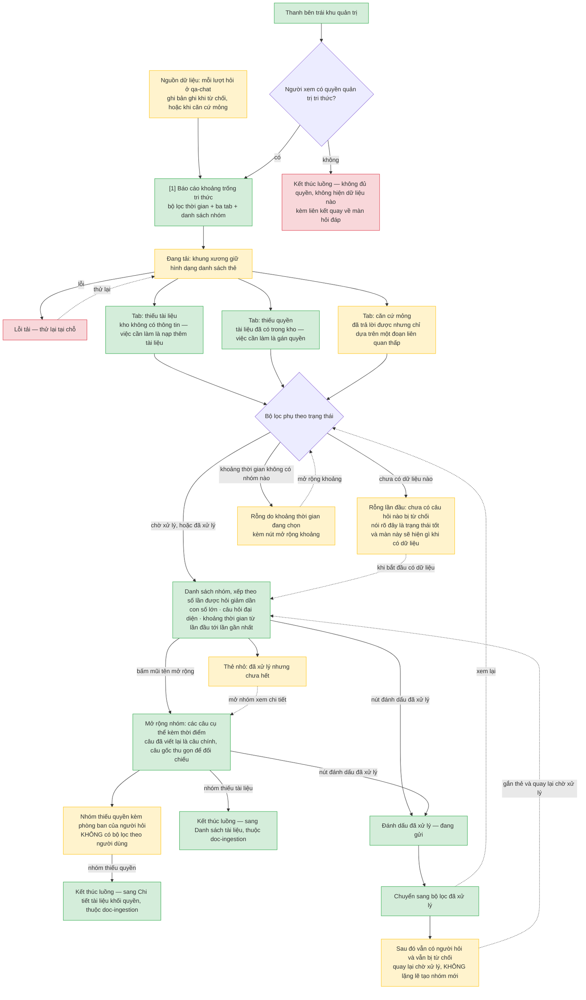

# Báo cáo khoảng trống tri thức — User Flow

> Nguồn chia luồng duy nhất của tính năng này. Khung vẽ **1024 điểm ảnh**.

Một màn, một luồng. Nhưng dữ liệu của nó sinh ra ở tính năng khác: mỗi lần `qa-chat` từ chối trả
lời, hoặc trả lời được nhưng căn cứ mỏng, là một bản ghi rơi vào đây.

## 1. User Flow (tổng)

### Flow: bao-cao-khoang-trong

## 2. Danh sách màn hình

| [#] | Slug | Mã màn | Màn hình | Mục đích | Luồng nhà | Dùng chung ở |
|-----|------|--------|----------|----------|-----------|--------------|
| 1 | `bao-cao-khoang-trong` | `SCR-knowledge-gap-01` | Báo cáo khoảng trống tri thức | Trả lời một câu hỏi: kho đang thiếu gì, và thiếu cái nào trước | `bao-cao-khoang-trong` | — |

## 3. Danh sách flow

| Flow-slug | Tên flow | Màn hình gồm | Cases phủ |
|-----------|----------|--------------|-----------|
| `bao-cao-khoang-trong` | Đọc và đóng khoảng trống tri thức | `bao-cao-khoang-trong` | happy (lọc, xếp theo tần suất, mở rộng nhóm, đánh dấu đã xử lý) · ba tab · đã xử lý nhưng chưa hết · rỗng lần đầu · rỗng do khoảng thời gian · đang tải · lỗi tải · không đủ quyền · đang gửi |

## 3.5. Chuyển màn

| Từ màn [#] | Đến màn [#] | Trigger | Điều kiện |
|-----------|------------|---------|-----------|
| Báo cáo [1] | (giữ nguyên) [1] | Đổi tab, đổi khoảng thời gian, đổi bộ lọc trạng thái | — |

**Lối vào và lối ra khỏi phạm vi tính năng:**

- Thanh bên khu quản trị → **Báo cáo [1]**, bấm mục *Khoảng trống tri thức*. Người không có quyền
  quản trị tri thức nhận thông báo, không thấy dữ liệu nào.
- Báo cáo [1] → màn **Danh sách tài liệu** của `doc-ingestion`, bấm liên kết trong một nhóm *thiếu
  tài liệu*. Đây là liên kết điều hướng, không phải nút hành động.
- Báo cáo [1] → màn **Chi tiết tài liệu** của `doc-ingestion`, bấm liên kết trong một nhóm *thiếu
  quyền*, khi xác định được tài liệu liên quan.

## 4. Điều phải giữ khi vẽ wireframe và viết spec

- **Không có bộ lọc theo người dùng, và không có đường nào liệt kê mọi câu một người đã hỏi.** Câu
  hỏi của nhân viên tiết lộ họ đang quan tâm việc gì; công cụ quản trị tri thức không được lặng lẽ
  biến thành công cụ giám sát. Đây là ranh giới cứng, không phải khuyến nghị.
- **Ba tab tách bạch vì việc cần làm khác hẳn nhau**, không phải vì dữ liệu khác nhau. Trộn chung
  thì con số tổng không nói lên điều gì hành động được.
- **Tab *căn cứ mỏng* không phải nhóm từ chối.** Những câu này hệ thống **đã trả lời được**; chúng
  là khoảng trống sắp thành vấn đề. Gộp vào tab *thiếu tài liệu* sẽ làm con số *số lần bị hỏi mà
  không trả lời được* trên mỗi thẻ sai nghĩa. Chốt 2026-09-09.
- **Từ chối vì câu hỏi ngoài phạm vi kho không tạo bản ghi** — đó không phải tín hiệu về kho tri
  thức. Câu hỏi rỗng hoặc quá ngắn bị chặn ngay ở khâu nhập cũng không tạo.
- **Nhóm đã xử lý mà vẫn bị hỏi thì quay lại chờ xử lý kèm thẻ riêng**, không tạo nhóm mới. Đây là
  tín hiệu tài liệu vừa nạp không trả lời được câu hỏi thật.
- Hai lý do kỹ thuật bên dưới *thiếu tài liệu* — không truy hồi được gì từ đầu, và mọi ý sinh ra bị
  loại vì không gắn được nguồn — **gộp hiển thị có chủ đích** vì việc khắc phục giống nhau. Chúng
  vẫn tách ở tầng dữ liệu theo `uc-refuse-answer` nhánh 1b2.

## 5. Việc phải đồng bộ ngược sang wireframe index

> Chủ ghi của `ascii-wireframe/knowledge-gap-wireframe-index.md` là `/wireframe-ascii`. Áp khi chạy
> skill đó, qua L2 diff.

1. **Thêm cột `Slug` vào bảng Screens**, lấy đúng slug ở Mục 2 trên.
2. **Ba tab thay vì hai** — thêm tab *căn cứ mỏng* vào mô tả màn, kèm giải thích vì sao nó không
   nằm chung với tab *thiếu tài liệu*.
3. **Thêm liên kết điều hướng** từ mỗi nhóm sang màn khắc phục thật, và ghi rõ mở rộng nhóm hiện
   câu đã viết lại làm câu chính.

## 6. Open Questions

- [ ] OQ-1: Phòng ban chỉ có một hai người thì hiển thị phòng ban ở nhóm *thiếu quyền* gần như bằng
      chỉ đích danh người hỏi. Có gộp phòng ban dưới N người vào cấp khối cha khi hiển thị không, và
      N bằng bao nhiêu? Chưa nguồn nào chốt; ở quy mô tổ chức hiện tại có thể chấp nhận được, nhưng
      phải quyết chứ không để trôi.
