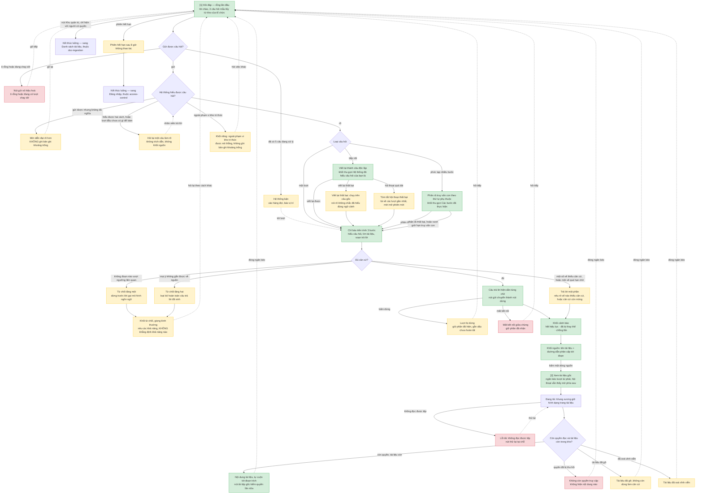

# Hỏi đáp có trích dẫn — User Flow

> Nguồn chia luồng duy nhất của tính năng này. `/wireframe-ascii` và `/wireframe-html` đọc file này
> để biết luồng nào gồm màn nào — không tự chia lại.

Khung vẽ: **1024 điểm ảnh** cho mọi luồng, theo `NFR-system-042` và mục 8 của hệ thống thị giác.

## 1. User Flow (tổng)

> Phủ happy, lỗi và biên. `[n]` là số màn hình, đối chiếu Mục 2. Nút bo tròn là điểm ra khỏi phạm vi
> tính năng này — chúng thuộc tính năng khác, không vẽ wireframe trong đợt này.

## 2. Danh sách màn hình

> Cột `Slug` là định danh máy đọc, khớp `## Screen: {slug}` bên wireframe. Cột `Luồng nhà` là nơi
> màn được vẽ; cột `Dùng chung ở` là các luồng khác đi qua nó mà không vẽ lại.

| [#] | Slug | Mã màn | Màn hình | Mục đích | Luồng nhà | Dùng chung ở |
|-----|------|--------|----------|----------|-----------|--------------|
| 1 | `hoi-dap` | `SCR-qa-chat-01` | Hỏi đáp | Đặt câu hỏi và nhận câu trả lời có trích dẫn | `hoi-dap` | — |
| 2 | `xem-tai-lieu-goc` | `SCR-qa-chat-02` | Xem tài liệu gốc | Kiểm chứng trích dẫn tại đúng đoạn rồi quay lại | `hoi-dap` | — |

## 3. Danh sách flow

| Flow-slug | Tên flow | Màn hình gồm | Cases phủ |
|-----------|-----------|--------------|-----------|
| `hoi-dap` | Hỏi đáp có trích dẫn | `hoi-dap` → `xem-tai-lieu-goc` | happy (một lượt, tiếp nối, phức tạp nhiều bước) · từ chối hai tầng, khối nêu các khả năng không khẳng định · ngoài phạm vi kho là khối riêng · trả lời một phần · hỏi lại làm rõ · lỗi (mất kết nối, hệ thống bận, phiên hết hạn, lỗi tải tài liệu) · biên (dừng lượt, viết lại thất bại, tóm tắt thất bại, quyền bị thu hồi, tài liệu đã gỡ hoặc đã xoá) |

Hai màn nằm chung một luồng vì quan hệ mở-từ-trích-dẫn rất chặt: mạch *gõ câu hỏi → thấy nguồn →
xác minh tại chỗ → quay lại hội thoại* sẽ gãy nếu tách qua hai tệp.

## 3.5. Chuyển màn

> Nguồn duy nhất cho việc nối điều hướng. Một dòng là một chuyển.

| Từ màn [#] | Đến màn [#] | Trigger | Điều kiện |
|-----------|------------|---------|-----------|
| Hỏi đáp [1] | Xem tài liệu gốc [2] | Bấm một dòng trong khối nguồn | Lượt đã hiện xong khối nguồn |
| Xem tài liệu gốc [2] | Hỏi đáp [1] | Đóng ngăn kéo | Mọi trạng thái, kể cả khi không còn quyền hoặc tài liệu đã gỡ |
| Hỏi đáp [1] | (giữ nguyên) [1] | Gửi câu hỏi | Không đủ nghĩa → mời diễn đạt lại; hoặc hệ thống hỏi lại làm rõ |

**Lối ra khỏi phạm vi tính năng** — không nằm trong bảng trên vì đích thuộc tính năng khác:

- Hỏi đáp [1] → màn **Đăng nhập** của `access-control`, khi phiên hết hạn 8 giờ không thao tác.
  Ghi nhớ trang đang mở để quay lại sau khi đăng nhập.
- Hỏi đáp [1] → màn **Danh sách tài liệu** của `doc-ingestion`, khi bấm nút *Khu quản trị* trên
  thanh trên. Nút chỉ hiện với người có quyền quản trị.

## 4. Điều phải giữ khi vẽ wireframe và viết spec

- **Khối từ chối nêu các khả năng, không khẳng định khả năng nào.** Giữ lối nói *"có thể chưa được
  cấp quyền"* **và cho nó hiện y hệt ở mọi lượt từ chối vì thiếu căn cứ** — lối nói mơ hồ chỉ bảo vệ
  được khi nó không đổi theo dữ liệu thật. Chỉ hiện nó khi thật sự có tài liệu bị chặn thì nó thôi
  là một khả năng và thành một câu khẳng định, lộ đúng thứ `AC-001` của US-008 cấm. Đổi thành câu
  khẳng định kiểu *"bạn không có quyền xem tài liệu này"* thì càng vi phạm. Lý do thật vẫn ghi chính
  xác vào dữ liệu khoảng trống tri thức, nơi chỉ quản trị đọc. Sửa 2026-09-23 theo `AC-003` của
  US-023; câu hỏi **ngoài phạm vi kho** là khối riêng, được nói thẳng (`AC-003b`).
- **Hỏi lại làm rõ là kết cục lượt thứ tư**, không phải lỗi và không phải từ chối. Nó không có khối
  nguồn, nên khung bốn phần của một lượt trả lời không áp cho nó.
- **Từ chối vì ngoài phạm vi kho không ghi bản ghi khoảng trống**; hai lý do còn lại thì có. Câu
  không đủ nghĩa cũng không ghi.
- **Bắt đầu phiên mới** đưa vùng hội thoại về trạng thái rỗng lần đầu; bối cảnh cũ không theo sang
  và không ảnh hưởng kết quả truy hồi của phiên mới (`AC-006` của US-021 và US-026).

## 5. Việc phải đồng bộ ngược sang wireframe index

> Chủ ghi của `ascii-wireframe/qa-chat-wireframe-index.md` là `/wireframe-ascii`. Áp khi chạy skill
> đó, qua L2 diff.

1. **Thêm cột `Slug` vào bảng Screens**, lấy đúng slug ở Mục 2 trên — đồ thị tri thức cần định danh
   máy đọc, hiện nó phải tự suy từ tên tiếng Việt.
2. **Thêm nút *Khu quản trị*** vào mô tả thanh trên của màn Hỏi đáp, kèm điều kiện chỉ hiện với
   người có quyền.
3. **Bổ sung ba trạng thái còn thiếu**: kết cục *hỏi lại làm rõ* ở màn Hỏi đáp; *đang tải* và *lỗi
   tải* ở ngăn kéo Xem tài liệu gốc.

## 6. Open Questions

- [ ] OQ-1: Hội thoại của phiên cũ có mở lại được không? Hiện không có màn lịch sử phiên nào trong
      danh sách 15 màn, nên mặc định là không. Nếu cần thì đây là màn thứ 16, quyết trước khi vẽ.
